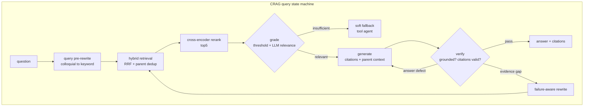

# DeepRAG

**Agentic RAG (Corrective RAG / CRAG) framework built on LangGraph 1.x** — hybrid retrieval with RRF fusion, Cross-Encoder reranking, a self-correcting retrieve→grade→generate→verify loop, multi-tenant JWT security, and a resumable ablation evaluation harness.

> 🇨🇳 中文文档：[README.md](README.md)（完整版）

## Why DeepRAG

Most RAG demos retrieve once and answer. DeepRAG implements **CRAG (Corrective Retrieval-Augmented Generation)** as an explicit state machine — and treats **evaluation as a first-class citizen**, so every retrieval/generation change can be measured, not vibes-reviewed.

## Features

### 🔄 Corrective RAG loop (LangGraph 1.x)
- `entry → pre_rewrite → retrieve → grade → generate → verify` with declarative `Command` routing
- Evidence gap → failure-aware **query rewrite** and re-retrieval; answer defect → verifier-feedback-driven regeneration
- Refusal calibration: rerank-score threshold (0.30, bimodal calibration) blocks the "answer anyway from weak evidence" hallucination path

### 🔀 Hybrid retrieval & reranking
- BGE-M3 dense + Qdrant **native BM25 sparse**, server-side weighted **RRF fusion** (`RETRIEVAL_SPARSE_WEIGHT`)
- Cross-Encoder reranking (BGE-Reranker-v2-M3) with self-heal retry and bad-window circuit breaker
- Ablated honestly: on short-document corpora sparse adds nothing (monotonically degrading), production default ≈ pure dense — reproducible conclusion, not a magic default

### 🧪 Evaluation as a first-class citizen
- **Golden ablation baseline**: 62 questions × 48 documents (incl. semantic near-duplicate distractors) + 10 unanswerable negatives
- **Independent cross-family LLM judge**: answer_correct / grounded / citation_correct
- **Honest-refusal rate**: unanswerable questions must refuse or flag unverified; fabricated citations count as dishonest
- **Chunk-resumable eval runner**: per-question checkpoint, bad-window circuit breaker, window fingerprint (rerank score drift across time windows identified and defended)

### 🏢 Multi-tenant security
- Forced JWT auth (401, no anonymous fallback); tenant propagated from token (request-body tenant ignored — anti-spoofing)
- KB ownership (`owner_id`): private KBs enforced across read/write/delete/upload/query (403 on violation), `kb_ids` validated one-by-one
- Per-user cache keys; conversation history filtered by ownership

### 💬 Serving & documents
- FastAPI + dual-channel SSE (agent step events + token streaming)
- PyMuPDF parsing → **parent-child chunking** (small-to-big context expansion)
- MySQL 8.0 (aiomysql) + Qdrant (dense+sparse) + Alibaba OSS + Redis; in-process async ingestion

## Architecture



## Benchmarks (golden v3, self-built eval set — 62q × 48 docs + 10 unanswerable)

| Config | R@1 | R@5 | nDCG@5 |
|---|---|---|---|
| dense-only | 0.839 | 0.938 | 0.895 |
| hybrid (RRF) | 0.834 | 0.938 | 0.893 |
| **funnel top20 → rerank5** | **0.903** | **0.944** | **0.926** |
| +CRAG (independent judge answer_correct) | 0.885 ~ 0.903 across windows | | |
| honest-refusal rate on unanswerable negatives | **10/10** | | |

> Honest caveat: numbers are from the project's own golden v3 set, not a public academic benchmark. All trials are archived under `docs/trials/` with mean±std baselines.

## Quick Start

```bash
docker compose up -d          # MySQL / Redis / Qdrant
python scripts/init_mysql.py  # schema
pip install -e .
cp .env.example .env          # fill OSS/Qdrant/MySQL/LLM/embedding credentials
python -m apps.api.main       # ingestion runs in-process (BackgroundTasks)
```

Query (auth required since P3):

```bash
TOKEN=$(curl -s -X POST http://localhost:8000/api/v1/auth/register \
  -H "Content-Type: application/json" \
  -d '{"email":"a@b.c","password":"secret66"}' | python -c "import sys,json;print(json.load(sys.stdin)['token'])")

curl -X POST http://localhost:8000/api/v1/query \
  -H "Content-Type: application/json" -H "Authorization: Bearer $TOKEN" \
  -d '{"question":"What retrieval stack does DeepRAG use?","mode":"kb"}'
```

## Roadmap

- [ ] **Reranker-side optimization**: the remaining colloquial-question gap is localized to cross-encoder scoring (docs retrieved but scored <0.30) → local reranker / per-question threshold calibration
- [ ] Long-term memory A/B re-evaluation (code retained, off by default)
- [ ] Deeper agent planning/tooling

## Docs

- [Baseline](docs/trials/baseline.md) · [Design](DESIGN.md) · [Trials archive](docs/trials/)

If DeepRAG helps your RAG engineering or learning, please consider giving it a **Star ⭐**.
