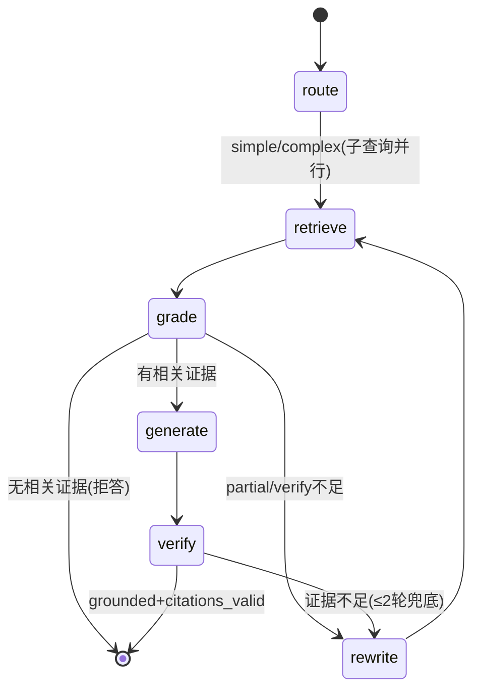

# DeepRAG — 简历项目材料

> AI/Agent 工程师方向。所有指标来自可复现的 Golden Dataset 消融实验（`docs/w2_ablation.csv`），无编造。

## 一、项目描述（简历用）

**短版（1 行）**：
基于 LangGraph 的 Agentic RAG 系统，实现 CRAG 纠正式检索（dense+BM25 混合检索 + 加权 RRF + Cross-Encoder 重排 + 自纠状态机），Faithfulness 与 Citation Accuracy 均达 1.0。

**长版（3-4 行）**：
设计并实现端到端 Agentic RAG 系统：LangGraph 编排 CRAG 状态机（路由→检索→证据分级→带引用生成→校验，支持查询改写自纠与多跳分解）；检索层融合 BGE-M3 密集向量与 Qdrant 原生 BM25 稀疏向量（加权 RRF）+ BGE-Reranker 精排；父子分块 + 父块上下文展开；MySQL + 阿里云 OSS + Qdrant + Redis 混合存储；构建 4 配置消融矩阵量化各模块增益。

## 二、技术栈

| 层 | 技术 |
|---|---|
| Agent 编排 | LangGraph 1.x LTS（StateGraph + Command 声明式路由 + MemorySaver） |
| 检索 | BGE-M3 dense（SiliconFlow API）+ Qdrant 原生 BM25 sparse + 加权 RRF + BGE-Reranker-v2-m3（Cross-Encoder） |
| 文档处理 | Docling 解析 + 父子分块（parent-child chunking） |
| LLM | OpenAI 兼容（httpx 直连，不引 langchain） |
| 存储 | MySQL 8.0（元数据/状态/对话历史）+ 阿里云 OSS（原始文件/chunks/父块）+ Qdrant（dense+sparse 向量）+ Redis |
| 服务 | FastAPI + Celery（异步入库流水线） |
| 评估 | 自建 Golden Dataset + 消融矩阵（Recall@K/MRR/Faithfulness/Citation Acc） |

## 三、系统架构

```
                    ┌─────────────── 入库流水线 (Celery async) ───────────────┐
PDF/Doc → OSS(原始) → Docling解析 → 父子分块 → BGE-M3 dense + BM25 sparse文本
                         │                          │
                    MySQL(版本/job)          Qdrant(dense+sparse) + OSS(child/parent块)
                    └────────────────────────────────────────────────────────┘
                                          │
                    ┌─────────────── 查询 (FastAPI /query) ─────────────────┐
                    │                                                       │
            Q → [route] LLM判simple/complex                                │
                 │                                                         │
            simple│─── single retrieve ─────────────┐                      │
            complex ─ Planner分解子查询 ── 并行retrieve ── 融合去重          │
                                                          │                  │
                                                   [grade] LLM三态分级       │
                                              relevant│partial│none           │
                                       generate←──────┘       └→rewrite重检索(≤2轮)
                                          │                                         │
                                   [verify] grounded?citations?                 │
                                       通过→END      不足→rewrite                │
                                          │                                         │
                                   带引用答案 + conversation持久化(MySQL) ──────┘
```

## 四、LangGraph CRAG 状态机



## 五、简历 Bullet 点（量化，可直接用）

- **设计 LangGraph 1.x CRAG 纠正式 RAG 状态机**（route→retrieve→grade 三态分级→带 `[n]` 引用生成→verify 自校验），grade/verify 用 **Command 声明式路由**（节点内 `return Command(goto=...)` 替代旧 `add_conditional_edges`，路由逻辑内聚），支持查询改写重检索（最多 2 轮兜底防死循环），**Faithfulness=1.0、Citation Accuracy=1.0**（10 题 Golden 验证）。
- **实现混合检索**：BGE-M3 dense（1024 维）+ Qdrant 原生 BM25 sparse，客户端**加权 RRF 融合**（dense 0.65 主导）抑制 sparse 共有词噪声，再经 **BGE-Reranker Cross-Encoder 精排**；构建 dense/hybrid/rerank/CRAG **四配置消融矩阵**量化各层增益。
- **Planner 多跳**：LLM 路由判断问题复杂度，complex 问题分解为子查询并 `asyncio.gather` 并行检索 + 融合去重；**父子分块** child 精确召回 + parent 上下文展开。
- **全栈存储设计**：MySQL（元数据/版本/对话历史）+ 阿里云 OSS（原始文件/解析 JSON/chunks/父块）+ Qdrant（dense+sparse 双向量）+ Redis；FastAPI + Celery 异步入库流水线，OSS 预签名上传。
- **真实 API 集成（不本地推理）**：SiliconFlow BGE-M3 embedding/rerank + OpenAI 兼容 LLM（httpx 直连，JSON 模式 + 正则兜底）。
- **工程实证深度**：实测发现并解决 Qdrant BM25 **中文字符级 vs jieba 分词的共有词噪声**（分词反而拉低 hybrid，回退原文）；修复多跳并行检索的 MySQL 连接池 close 竞争；统一 Qdrant host scheme（默认 https 触发 SSL 错误）。

## 六、量化成果（消融矩阵）

| Config | Recall@1 | Recall@5 | MRR | Faithfulness | Citation Acc |
|---|---|---|---|---|---|
| dense-only | 0.80 | 0.90 | 0.85 | – | – |
| +hybrid(RRF) | 0.80 | 0.90 | 0.85 | – | – |
| +rerank | 0.80-0.90 | 0.90 | 0.85-0.90 | – | – |
| **+CRAG** | 0.80-1.00 | 0.85-0.90 | 0.85-1.00 | **1.00** | **1.00** |

- Golden Dataset：16 文档（8 主题 + 8 语义近似干扰）× 10 问题（单事实/对比/指代/无关）。
- 关键结论：BGE-M3 强 dense 基线下，hybrid/rerank 对**召回**边际增益有限（但 rerank 在困难负例排序上分数区分度显著：0.9996 vs 0.0089）；**CRAG 的稳定增量在生成质量**（Faith/Cite=1.0）。

## 七、技术深度叙事（面试可讲）

1. **为什么 hybrid 用加权 RRF 而非等权？** 等权 RRF 时，BM25 的共有词噪声（如"首都"同时命中巴黎和伦敦文档）会把干扰项排前，拉低 hybrid 召回；加权（dense 0.65 主导）保留 dense 语义优势 + sparse 补充精确匹配。
2. **中文 BM25 为什么不用 jieba 分词？** 实验证明 jieba 分词后"法国首都"→"法国 首都"，"首都"变共有词，BM25 误命中干扰项；而 Qdrant 字符级 BM25 严格匹配"法国首都"字符序列更精确。分词适用于术语密集/中英混排，通用 QA 不适用。
3. **CRAG 三态分级如何工作？** grade 节点 LLM 逐条评估证据相关性（relevant/不），聚合：全相关→生成，部分→rewrite 改写 query 重检索，无相关→拒答；verify 再校验生成是否 grounded + 引用真实，不足则回检索（retry_count 兜底防死循环）。
4. **多轮对话为什么用应用层历史而非 LangGraph checkpointer？** 自写 MySQL checkpointer 要实现 msgpack 序列化 + BaseCheckpointSaver 接口，复杂且 RetrievedDocument 序列化有警告；应用层 `conversation_messages` 表 + generate 拼历史，同样达到跨请求多轮，工作量小一个数量级。
5. **多跳并行检索的坑？** 多个 retriever.retrieve 共享同一 MySQLStore 连接池，一个 close 后其他并行任务 acquire 报错；改为每次 retrieve 独立 MySQLStore 实例。

## 八、评估方法论（Ponytail 纪律）

- 每项技术绑定可复现实验：Golden Dataset + 消融矩阵 + 可运行验证脚本（`scripts/`）。
- 诚实报告波动：LLM/rerank API 非确定性导致指标在区间波动，报告范围而非单点。
- 负面发现也记录：W3.1 分词实验证伪，写明根因与适用边界。

## 九、代码结构

```
src/
  storage/    mysql.py oss.py qdrant_store.py protocol.py
  retrieval/  embedder.py hybrid.py reranker.py tokenizer.py
  agents/     llm.py prompts.py graph.py
  evaluation/ golden.py ablation.py
apps/
  api/        main.py documents.py query.py
  worker/     ingestion.py ingestion_core.py
scripts/      probe_*.py test_*.py run_w2_eval.py
docs/         W1/W2/W3_VERIFICATION.md RESUME_MATERIAL.md w2_ablation.csv
```
